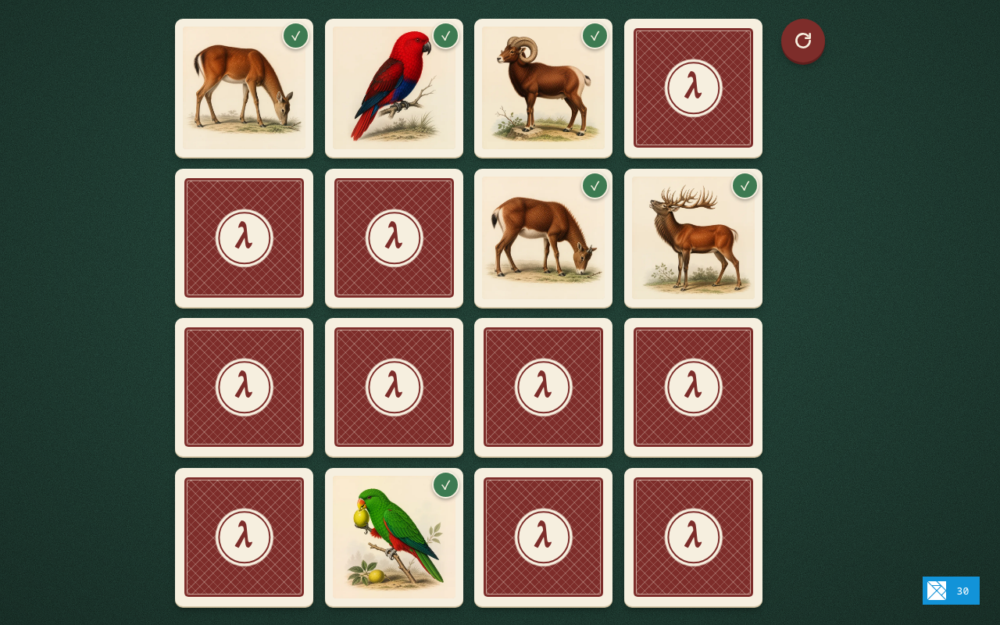
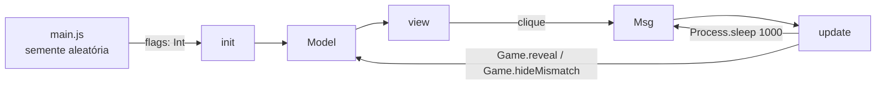

# Jogo da Memória

Jogo da memória educacional escrito em [Elm](https://elm-lang.org), feito
para ensinar programação funcional. Em vez de juntar cartas idênticas, o
jogador junta cartas **relacionadas**: no tema que vem pronto, o macho e a
fêmea de cada espécie.



## Como jogar

- O tabuleiro tem 16 cartas (4 × 4) em 8 grupos. Cada grupo tem duas cartas
  diferentes, mas relacionadas: no tema que vem pronto, o macho e a fêmea de
  uma espécie (leão e leoa, pavão e pavoa, galo e galinha...).
- Vire duas cartas por jogada. Se forem do mesmo grupo, formam um par.
- As cartas erradas ficam à mostra por 1 segundo e voltam a ficar viradas.
- Passe o mouse sobre um par já encontrado para ampliar a carta.
- O botão redondo ao lado do tabuleiro começa um jogo novo.

## Como rodar

Pré-requisitos: Node.js 20 ou mais novo e pnpm. O compilador Elm vem como
dependência do projeto, não precisa instalar à parte.

```sh
pnpm install     # instala Vite, Elm, elm-test e elm-format
pnpm dev         # servidor com hot reload em http://localhost:5173
```

Com `pnpm dev` aberto, salvar qualquer arquivo `.elm` ou `.css` atualiza a
página sem perder o estado da partida. No canto da tela aparece o depurador
do Elm, que mostra cada mensagem e deixa voltar no tempo.

| Comando        | O que faz                                                     |
| :------------- | :------------------------------------------------------------ |
| `pnpm dev`     | Servidor de desenvolvimento com hot reload e depurador do Elm |
| `pnpm test`    | Roda os testes de `tests/` com elm-test                       |
| `pnpm build`   | Gera o site estático otimizado em `dist/`                     |
| `pnpm preview` | Serve o conteúdo de `dist/` para conferir o build             |
| `pnpm format`  | Formata o código Elm com elm-format                           |
| `pnpm check`   | Formatação, testes e build; é o que define "pronto"           |

O conteúdo de `dist/` é estático: dá para publicar em qualquer servidor de
arquivos (GitHub Pages, Netlify, uma pasta do Apache), inclusive em
subpastas, porque os caminhos são relativos.

## Tecnologias

| Ferramenta           | Papel                                                                                                                         |
| :------------------- | :---------------------------------------------------------------------------------------------------------------------------- |
| Elm 0.19             | Linguagem do jogo. Só usa `elm/core`, `elm/html` e `elm/browser`                                                              |
| Vite                 | Servidor de desenvolvimento, hot reload e build                                                                               |
| vite-plugin-elm      | Compila os módulos Elm dentro do Vite                                                                                         |
| elm-test             | Testes unitários e testes com entradas aleatórias (fuzz)                                                                      |
| elm-format           | Formatação padrão do código Elm                                                                                               |
| HTML semântico e CSS | Estrutura com `main`, `ol`, `button` e `dialog`; visual todo em CSS                                                           |
| Fontsource           | Fontes Alegreya e Alegreya Sans servidas pelo próprio site, sem CDN                                                           |
| WebP                 | Cartas no estilo de pranchas de história natural: geradas por IA (padrão) ou gravuras de domínio público de Buffon e Schreber |

O projeto não usa JSON, `Http`, portas nem bibliotecas de terceiros em Elm. O
único dado que vem do JavaScript é um número inteiro, passado nas flags, que
serve de semente para o embaralhamento.

## Arquitetura

```
memoria/
├── index.html            página que recebe o app
├── vite.config.js
├── elm.json
├── public/
│   ├── favicon.svg
│   └── cards/
│       ├── ia/           16 imagens geradas por IA (padrão) e CREDITS.md
│       └── gravuras/     16 gravuras de domínio público e CREDITS.md
├── src/
│   ├── main.js           inicia o Elm e passa a semente
│   ├── Main.elm          Arquitetura Elm: modelo, mensagens, update e view
│   ├── Game.elm          regras do jogo, sem nada visual
│   ├── Rng.elm           gerador de números aleatórios puro (fornecido)
│   └── styles/
│       └── main.css      visual e animações (fornecido)
└── tests/
    ├── GameTest.elm      regras do jogo
    └── RngTest.elm       gerador e embaralhamento
```

### O que os alunos escrevem e o que vem pronto

O núcleo do jogo fica em dois módulos curtos, que os alunos leem e escrevem:

- `Game.elm`: as regras como funções puras de `Game` para `Game`.
- `Main.elm`: a Arquitetura Elm que liga as regras à tela.

O resto é infraestrutura fornecida e pode ter mais complexidade:

- `Rng.elm`: gerador congruencial linear e embaralhamento de Fisher-Yates.
- `styles/main.css`: visual de mesa de jogo (feltro verde, cartas de
  papel-cartão, verso estampado como baralho antigo), layout, virada 3D, zoom nos
  pares encontrados, botão redondo de novo jogo com ícone
  e suporte a `prefers-reduced-motion`.
- `public/cards/ia/` e `public/cards/gravuras/`: dois conjuntos de
  imagens. O padrão é o de IA; `cardsFolder` em `src/Main.elm` escolhe
  qual usar. O código só conhece os nomes dos arquivos: `a1.webp` faz par
  com `a2.webp`, e assim por diante. Cada pasta tem um `CREDITS.md` com a
  origem das imagens.

### Fluxo de dados



1. `src/main.js` sorteia um inteiro com `crypto.getRandomValues` e o passa
   como flag. Como a flag é um `Int`, o Elm a aceita sem decoder.
2. `Main.init` cria a semente com `Rng.seed` e chama `Game.new`, que embaralha
   as cartas e devolve a semente seguinte, guardada para a próxima partida.
3. Cada clique gera `CardClicked id`. O `update` chama `Game.reveal`, que
   devolve o jogo novo.
4. Se o `turn` passou de `OnePicked` para `Mismatch`, o `update` agenda
   `MismatchTimeout` com `Process.sleep`. Quando ele chega,
   `Game.hideMismatch` desvira as duas cartas.
5. A `view` lê o modelo e escolhe classes CSS (`card--up`, `card--matched`,
   `card--miss`). Todas as animações acontecem no CSS.

### O modelo do jogo

```elm
type alias Game =
    { cards : List Card
    , turn : Turn
    , moves : Int
    }

type alias Card =
    { id : Int, group : Char, member : Int, face : Face }

type Face = FaceDown | FaceUp | Matched

type Turn
    = Waiting              -- nenhuma carta virada nesta jogada
    | OnePicked Int        -- uma carta virada
    | Mismatch Int Int     -- duas cartas erradas à mostra
```

O `Turn` torna impossível representar estados inválidos, como três cartas
viradas ao mesmo tempo. A regra de similaridade cabe numa linha:

```elm
isPair : Card -> Card -> Bool
isPair a b =
    a.group == b.group && a.member /= b.member
```

## Como trocar o tema

A mecânica serve para qualquer relação entre pares: maiúscula e minúscula,
país e capital, filhote e adulto. Para trocar as imagens:

1. Crie uma pasta em `public/cards/` (por exemplo, `public/cards/ia/`) com
   16 arquivos chamados `a1` a `h2`. O `1` e o `2` de cada letra formam um par.
2. Em `src/Main.elm`, aponte `cardsFolder` para a pasta nova e ajuste
   `cardsExtension` se o formato for outro (`.png`, `.jpg`...).
